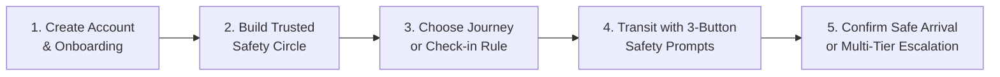

<div align="center">


# DigiSakhi
### *For Her. With Her. Always.*

**A proactive, privacy-first women's safety companion engineered for daily commutes, solo travel, and instant emergency response.**

<br/>

[](https://safesphere-liart.vercel.app)

<br/>

[](https://safesphere-liart.vercel.app)
[](https://safesphere-liart.vercel.app)
[](https://react.dev)
[](https://tailwindcss.com)
[](https://vitejs.dev)
[](LICENSE)

</div>

---

## 💡 The Problem DigiSakhi Solves

Women navigating late-night commutes, public transit, and unfamiliar routes often experience deep safety anxiety. Yet traditional personal safety apps fail users in critical ways:

1. **Panic Induction & False Alarms:** Traditional single-tap SOS alarms immediately dispatch police or broadcast emergencies to family for benign delays or dead batteries, creating embarrassment and reluctance to use the app.
2. **Expensive Telecom Gateways:** Most emergency apps require paid SMS gateway subscriptions (e.g. Twilio, AWS SNS) that silently fail when credits expire or credentials break.
3. **Invasive 24/7 Surveillance:** Constant background tracking drains batteries and exposes sensitive daily movement patterns to cloud servers.
4. **Zero Shoulder-Surfing Privacy:** Opening a safety app in transit visibly signals vulnerability to onlookers and abusers.

**DigiSakhi rethinks women's personal safety from the ground up:**
- **Proactive, Not Alarmist:** Check-in reminders enter gentle grace period buffers before escalating, eliminating accidental false alarms.
- **Zero-Cost Native Dispatch:** Deep integration with WhatsApp (`https://wa.me/`) and device messaging (`sms:`) dispatches alerts with live Google Maps GPS coordinates with zero paid gateway accounts.
- **Sequential Multi-Tier Escalation:** Contacts are prioritized into Tier 1 and Tier 2 responders, escalating only if the primary responder does not acknowledge.
- **Instant Escape-Key Camouflage (<kbd>Esc</kbd>):** Immediately overlays the interface with an innocent disguise app (*Weather Forecast*, *Shopping Notes*, or *Working Calculator*) while active monitoring continues running safely in the background.

---

## 🌆 A Realistic Day in the Life with DigiSakhi

> **8:45 PM — Elena's Evening Commute:**  
> Elena boards a crowded bus home from her university campus. Rather than feeling anxious or triggering an aggressive panic alarm, she launches a **15-Minute DigiSakhi Safety Journey** with a 200-meter safe arrival perimeter around her apartment.
> 
> - **At 9:00 PM:** Her phone vibrates gently with a check-in reminder. She taps **"I'm Okay 💚"** with one touch, seamlessly resetting the timer for the next leg of her trip.
> - **At 9:10 PM:** A stranger stands too close and looks over her shoulder. Elena taps <kbd>Esc</kbd> (or the Quick Exit button). Her screen instantly becomes a realistic **Working Calculator**. In the background, her journey timer and GPS arrival detector continue running untouched.
> - **At 9:25 PM:** Elena enters her apartment gate. DigiSakhi detects that she is within the 200m safe radius, automatically prompts her arrival confirmation, and terminates location sharing upon confirmation.

---

## 🔄 How DigiSakhi Works (5-Step User Journey)



1. **Create Account & Secure Setup:** Register securely with salted password hashing. Complete a 5-step onboarding wizard to establish identity, emergency medical info, and emergency numbers.
2. **Build Your Trusted Circle:** Add primary (Tier 1) and backup (Tier 2) responders. Send instant WhatsApp or SMS invite links allowing contacts to verify and connect.
3. **Choose Your Safety Companion:** Plan a **Custom Safety Journey** with tailor-made check-in intervals, or configure an **Automated Safety Check-in**.
4. **Active Transit & Responsive Prompts:** Receive scheduled check-in reminders and respond in 1 tap:
   - **I'M OKAY 💚** — Confirms safety and schedules the next interval.
   - **I NEED HELP 🟠** — Opens direct phone dialer for your Tier 1 contact and logs a call action.
   - **URGENT HELP 🚨** — Instantly initiates emergency dialer for national helpline **112**.
5. **Safe Arrival or Escalation:** Arriving within the destination's geofenced perimeter prompts arrival confirmation and stops location sharing. If an overdue check-in elapses unacknowledged, alerts escalate sequentially to Tier 1 and Tier 2 contacts.

---

## 🌟 Strongest Implemented Features

### 🛡️ Custom Safety Journey Engine
- **Configurable Check-in Frequencies:** Choose 5, 10, 15, 20, 30 min, or custom durations with adjustable response countdown windows (60s to 300s).
- **Assigned Escalation Tiers:** Explicitly designate which circle member is dialed first when help is needed, and who serves as the secondary escalation.
- **Geofenced Safe Arrival:** Real-time Haversine distance calculation detects entry into safe radius (100m, 200m, 500m) and prompts the user to end transit securely.

### 👥 Trusted Safety Circle & Recipient Portal
- **Sequential Tier 1 & Tier 2 Hierarchy:** Reorder contacts seamlessly with verified escalation badges (`#1`, `#2`).
- **Live Recipient Verification Portal (`/invite?token=...`):** Recipients open a secure, branded page to review permissions and accept their role, automatically reconciling from *Pending* to *Connected*.
- **Data Isolation:** Circle members only access alerts specifically directed to them; unverified contacts cannot view user coordinates.

### 💬 Zero-Cost WhatsApp & Native SMS Integration
- **Platform-Compliant SMS Composer:** Launches iOS (`sms:&body=`) and Android (`sms:?body=`) native messaging apps with pre-filled distress messages and recipient numbers.
- **WhatsApp Click-to-Chat:** Generates official `https://wa.me/` URLs for 1-click sharing of invitation tokens and emergency broadcasts.
- **Strict Phone Normalization:** Automatically standardizes Indian 10-digit mobile numbers (`9876543210` → `+919876543210`) and international formats.

### 🎭 Escape-Key Quick Camouflage (<kbd>Esc</kbd>)
- **Instant Disguise:** Pressing <kbd>Esc</kbd> anywhere immediately transforms the screen into one of three realistic innocent apps:
  - 🌦️ **Metro Weather & Daily Agenda:** Live forecast, hourly cards, and daily task checklist.
  - 📝 **Personal Notebook & Grocery Checklist:** Functional categorised notes with toggleable checklist items.
  - 🔢 **Standard Desk Calculator:** Working math calculator with digits, operations, and live calculation display.
- **Background Protection:** Active journeys, check-ins, and emergency escalations remain running silently while disguised.
- **PIN-Protected Return:** Type private PIN (`1234` or custom) to safely restore the session.

### 🚨 Emergency SOS Broadcast & Helpline Dialers
- **1-Click SOS Broadcast:** Compiles an emergency alert with live Google Maps GPS coordinates, situation notes, and recipient numbers via WhatsApp or native SMS.
- **Helpline Phone Dialers:** One-tap telephony links (`tel:112`, `tel:1091`, `tel:100`) pre-fill the native phone dialer for India's all-in-one 112 emergency helpline or women's safety helplines.

### 📊 Transparent Activity History & Audit Trails
- **Chronological Security Logs:** Timestamped audit entries for every check-in prompt, response, grace period countdown, and dialer action.
- **Encrypted Data Export:** Export the complete user profile and security timeline as a structured JSON file.

---

## 🛠️ Technology Stack & Architecture

| Layer | Technologies | Architectural Role |
| :--- | :--- | :--- |
| **Frontend Framework** | **React 18.3.1 + TypeScript 5.8** | Component-driven UI with end-to-end type safety |
| **Bundler & Build Tool** | **Vite 6.2.0** | Sub-second HMR, tree-shaking, and optimized production builds |
| **Styling & Design System** | **Tailwind CSS 3.4** | Custom DigiSakhi brand tokens (`#5517C8` Royal Purple, `#365BFF` Electric Blue, `#FAF9FF` Canvas) |
| **Interactive Maps** | **Leaflet 1.9 + OpenStreetMap** | Open-source interactive transit maps and geofence circles |
| **State & Business Logic** | **React Context API + Custom Engine** | Dynamic check-in scheduler, wall-clock timing, and event bus |
| **Dual-Mode Persistence** | **LocalStorageDB + Vercel Functions** | Zero-config standalone demo mode with multi-device cross-device recovery (`/api/account`) |
| **Automated Testing** | **Node.js Test Runner + esbuild** | Comprehensive QA suite (**45 tests across 18 test suites**) |
| **Production Hosting** | **Vercel Production Edge** | Global CDN distribution and serverless API execution |

---

## ⚡ Quick Start (Local Setup)

### Prerequisites
- **Node.js:** v18.0.0 or later (v20.x or v22.x recommended)
- **npm:** v9.0.0 or later
- **Git**

### Installation & Run Commands

```bash
# 1. Clone the repository
git clone https://github.com/mohnisha0810/DigiSakhi.git
cd DigiSakhi

# 2. Install dependencies
npm install

# 3. Start local development server
npm run dev
```

Open [http://localhost:5173](http://localhost:5173) in your browser.

```bash
# 4. Run the automated QA test suite (45/45 tests)
npm test

# 5. Build for production
npm run build

# 6. Preview the production build locally
npm run preview
```

---

## ⚙️ Backend Architecture: Dual-Mode Persistence

DigiSakhi features an architectural **Dual-Mode Backend** designed for instant zero-configuration evaluation while supporting enterprise cloud deployments:

- **Mode 1: Zero-Config Standalone Mode (Default):**
  - Requires **zero external API keys, credit cards, or accounts**.
  - All user profiles, trusted contacts, journeys, and check-in records persist persistently in `localStorage`.
  - In production, accounts synchronize through Vercel Serverless Functions (`/api/account`) to support multi-device logins.
  - Tab instances synchronize in real-time using the browser `BroadcastChannel` API.
- **Mode 2: Supabase Cloud PostgreSQL Mode (Optional):**
  - Connect your own Supabase project by providing `VITE_SUPABASE_URL` and `VITE_SUPABASE_ANON_KEY` in `.env`.
  - Full PostgreSQL migrations with Row Level Security (RLS) are included in `supabase/migrations/`.

---

## 🔒 Privacy, Safety & Browser Constraints

To ensure complete transparency during hackathon evaluation, the following operational and browser security safeguards are documented:

1. **No Silent Background Calls:** Web browsers cannot initiate cellular telephone calls in the background without user interaction. DigiSakhi uses standard `tel:<number>` schemes to launch the native dialer pre-filled with the assigned responder or 112, requiring one deliberate tap to connect.
2. **No Silent Background SMS:** Browsers do not permit silent SMS sending without paid gateways. DigiSakhi uses platform-native `sms:` and WhatsApp click-to-chat protocols so users can dispatch messages directly through their device at **zero cost**.
3. **Session-Only GPS Location:** Location sharing is strictly activated only during active journeys or explicit SOS distress alerts. DigiSakhi **never** conducts 24/7 background surveillance.
4. **Mobile Tab Throttling Protection:** When mobile browser tabs are minimized, browsers throttle JavaScript timers. DigiSakhi's scheduler calculates absolute wall-clock timestamps (`Date.now()`), instantly catching up on overdue check-ins the moment the tab is reopened.

---

## 👩‍⚖️ 5-Minute Evaluation Guide for Hackathon Judges

To evaluate DigiSakhi in live production, follow this 5-minute walkthrough:

1. **Open the Live Website:** Visit [https://safesphere-liart.vercel.app](https://safesphere-liart.vercel.app).
2. **Register a Test Account:** Click **Create Account** and register with any test email and password.
3. **Experience Onboarding:** Follow the 5-step wizard to set your name, add a sample contact, select a check-in interval, and verify emergency settings.
4. **Test Trusted Circle & Recipient Portal:**
   - Go to **Circle** and view your added contact.
   - Click **WhatsApp** or **SMS** to review the pre-formatted invite link.
   - Click **Review Portal** to open the recipient acceptance page in a new tab and click **Accept Invitation**.
   - Return to DigiSakhi — notice the status automatically updates to **Connected**.
5. **Launch a Custom Safety Journey:**
   - Go to **My Journey** and select **Customize My Own Safety Plan**.
   - Configure a 5-minute interval, assign your contact as Tier 1, and click **Start Custom Safety Journey**.
   - When the prompt appears, test the three response options: *"I'M OKAY 💚"*, *"I NEED HELP 🟠"*, or *"URGENT HELP 🚨"*.
6. **Trigger Escape-Key Quick Camouflage:**
   - Press the physical <kbd>Esc</kbd> key on your keyboard (or click **Quick Exit** in the sidebar/header).
   - Observe the instant transformation into a realistic Weather, Notes, or Calculator app.
   - Enter PIN `1234` and click Return to restore your active safety dashboard.

---

## 📄 License & Attribution

- **Project:** DigiSakhi Women's Safety & Empowerment Platform
- **Tagline:** *"For Her. With Her. Always."*
- **Live Production Platform:** [https://safesphere-liart.vercel.app](https://safesphere-liart.vercel.app)
- **GitHub Repository:** [https://github.com/mohnisha0810/DigiSakhi](https://github.com/mohnisha0810/DigiSakhi)
- **License:** MIT License — Open for evaluation and personal safety research.
